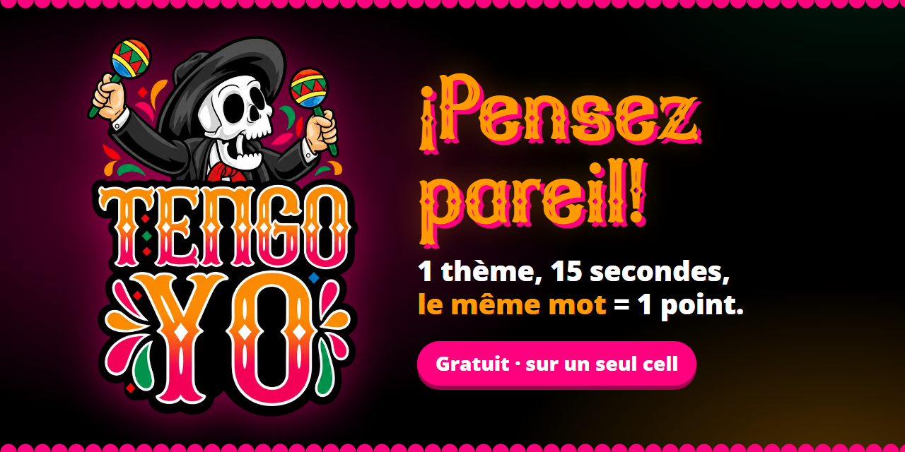
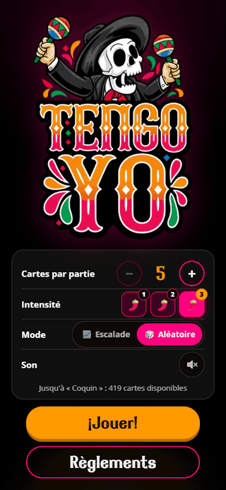
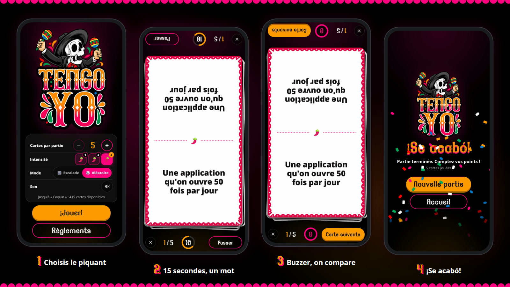

<div align="center">

<a href="https://patricepoliquin.com/tengoyo/"></a>

# Tengo Yo

[](https://patricepoliquin.com/tengoyo/)
[](data/questions.json)

[](CHANGELOG.md)
[](LICENSE)

**Ton coéquipier et toi, vous pensez vraiment pareil ? Vous avez 15 secondes pour le prouver.**

💀 Le party game où il faut écrire **le même mot** que son coéquipier, sur un seul cell posé au milieu de la table 🌶️

[**▶️ Jouer maintenant**](https://patricepoliquin.com/tengoyo/) · [📜 Comment jouer](#comment-jouer) · [🧾 Feuilles à imprimer](#-feuilles-à-imprimer) · [🇬🇧 English](#-in-english)

</div>

<br>

<table>
<tr>
<td width="340" align="center">

</td>
<td>

**Une manche en 20 secondes**

> 🃏 **La carte :** « Une application qu'on ouvre 50 fois par jour »

Chacun écrit un mot, en secret. Au buzzer, on dévoile :

| Équipe | Réponses | Points |
| --- | --- | :---: |
| 🟠 Équipe 1 | Instagram · TikTok | 0 |
| 🩷 Équipe 2 | TikTok · TikTok | **+1** |
| 🟢 Équipe 3 | Météo · Messenger | 0 |

L'Équipe 1 a joué la réponse évidente. L'Équipe 2 a deviné celle de son coéquipier.
**Toute la partie se joue dans cet écart.** On ne cherche pas la bonne réponse : on cherche *la même*.

</td>
</tr>
</table>

## 🎉 Pourquoi Tengo Yo

La plupart des party games demandent une boîte, un paquet de cartes à brasser et quelqu'un qui lit les règles à voix haute. Les jeux sur téléphone, eux, finissent souvent avec chacun le nez dans son écran.

Avec **Tengo Yo**, on pose **un seul cell à plat au centre de la table**. La carte est écrite à l'endroit **et** à l'envers : tout le monde la lit, peu importe où il est assis. Les joueurs écrivent sur papier et se regardent dans les yeux au moment de dévoiler.

<div align="center">

| | |
| --- | --- |
| **Pour commencer** | 30 secondes : ouvrir le lien, appuyer sur « Jouer » |
| **Cartes** | 431, en 3 niveaux de piquant, dont des devinettes |
| **Matériel** | 1 cell, 1 crayon et 1 feuille par joueur |
| **Prix** | Gratuit, sans pub, sans compte, sans téléchargement |
| **Poids** | Moins de 1,5 Mo, aucun serveur ni base de données |

</div>

### Pourquoi c'est si drôle

- **Le dilemme à chaque carte.** Tu veux écrire la réponse la plus évidente, *mais* ton coéquipier, lui, va-t-il jouer la plus drôle ? C'est ce choix, refait à chaque carte, qui rend le jeu prenant.
- **La pression du chrono.** 15 secondes, c'est assez pour hésiter et pas assez pour réfléchir. Le cercle vire au rouge dans les 5 dernières secondes, puis le buzzer tombe.
- **Le moment du dévoilement.** Deux mots identiques déclenchent des cris. Deux mots complètement différents, un fou rire.
- **Une partie qui monte en piquant.** En mode *Escalade*, la soirée commence sur des cartes loufoques et finit sur des sous-entendus 🌶️🌶️🌶️.
- **Des cartes à double sens.** « Un truc qu'on fait avec la langue pour impressionner »… Chacun l'entend à sa façon, et c'est là que les fous rires commencent.

<div align="center">

</div>

## Fonctionnalités

- **Carte lisible des deux côtés** de la table, avec le piment d'intensité au milieu.
- **3 niveaux de piquant** : 🌶️ Loufoque, 🌶️🌶️ Irrévérencieux, 🌶️🌶️🌶️ Coquin. Tu choisis le niveau maximum.
- **2 modes de jeu** : *Escalade* (le piquant monte au fil de la partie) ou *Aléatoire* (tout est mélangé).
- **De 5 à 100 cartes** par partie (20 par défaut).
- **Passer une carte** qui ne plaît à personne. Elle ne compte pas et une autre la remplace.
- **Peu de répétitions** : le jeu retient les cartes déjà vues sur l'appareil et pige d'abord les nouvelles.
- **Décompte, buzzer et vibration**, avec une musique d'ambiance sur l'accueil. Un bouton coupe le son.
- **L'écran reste allumé** pendant la partie. Le chrono se met en pause si on quitte l'app.
- **Accessible** : la question est lue par les lecteurs d'écran, et les animations sont réduites quand le téléphone le demande.

## Comment jouer

1. **Formez des équipes de deux** (ou jouez chacun pour soi). Chaque joueur a une feuille et un crayon.
2. **Posez le cell à plat au centre de la table.**
3. **Une carte se retourne** avec un thème, par exemple « Un animal à fourrure ».
4. **15 secondes** pour écrire **un seul mot**, sans se parler ni se faire de signes.
5. **Au buzzer, on dévoile.** Même mot que ton coéquipier ? **+1 point** pour l'équipe.
6. **En solo :** 1 point pour chaque joueur qui a écrit le même mot que toi.
7. L'équipe qui a le plus de points à la fin gagne.

> [!NOTE]
> Jeu pour adultes : humour irrévérencieux et sous-entendus, mais **aucun contenu sexuel explicite**. Ce qui se dit autour de la table reste autour de la table.

## 🧾 Feuilles à imprimer

Elles sont accessibles depuis l'écran **Règlements** (section « À imprimer ») ou directement :

| Feuille | Usage | Fichiers |
| --- | --- | --- |
| **Réponses** | Une par joueur. Logo et code QR pour lancer le jeu. | [`print/reponses.html`](print/reponses.html) · [PDF](print/tengo-yo-reponses.pdf) |
| **Pointage** | Une par table. 6 colonnes d'équipes, points comptés en bâtons. | [`print/pointage.html`](print/pointage.html) · [PDF](print/tengo-yo-pointage.pdf) |

Dans la fenêtre d'impression, choisis le format Lettre et décoche « En-têtes et pieds de page ».

## 🇬🇧 In English

<details>
<summary><b>Tengo Yo</b> is a free, French-language party game played on one phone. Click to read more.</summary>

<br>

A card shows a prompt, for example *"An app you open 50 times a day"*. Everyone has **15 seconds to write one word**. If you wrote **the same word as your teammate**, your team scores a point. You're not looking for the right answer, but for *the same* one.

- One phone lies flat in the middle of the table. The card reads both ways, so everyone can see it.
- 431 cards in 3 spice levels (silly, irreverent, cheeky), including riddles. No explicit content.
- Two modes: *Escalade* (spice ramps up) or *Aléatoire* (random).
- Pure HTML, CSS and JS. No build, no backend, no account, no ads.

[**▶️ Play now**](https://patricepoliquin.com/tengoyo/). The cards are in French (Québec).

</details>

---

## Pour les devs

Une web app mobile **100 % client-side** : HTML, CSS et JavaScript (modules ES), sans framework, sans étape de build et sans base de données. Les animations utilisent [GSAP](https://gsap.com/), hébergé localement.

### Lancer en local

Les questions sont chargées en JSON. Il faut donc un petit serveur web : ouvrir `index.html` en double-clic ne fonctionne pas.

```bash
git clone https://github.com/poliquinp/tengo-yo.git
cd tengo-yo
python -m http.server 4790
# puis http://localhost:4790
```

Pour tester sur un cellulaire du même réseau Wi-Fi : `python -m http.server 4790 --bind 0.0.0.0`, puis `http://<IP-du-PC>:4790`.

### 📦 Déployer

Téléverse le dossier tel quel sur n'importe quel hébergement statique : Netlify, GitHub Pages, serveur Apache ou Nginx, FTP…

- **À téléverser :** `index.html`, `site.webmanifest`, `sitemap.xml`, `css/`, `js/`, `data/`, `assets/`, `vendor/`, `print/`.
- **Inutiles en ligne :** `ref/`, `tools/`, `docs/`, `.claude/`, `.agents/`, `README.md`.

### Structure

```text
index.html            Écrans : accueil, règlements, décompte, partie, fin (+ balises SEO)
site.webmanifest      Installation sur l'écran d'accueil
sitemap.xml           Plan du site pour Google
css/styles.css        Charte Día de Muertos, mise en page mobile verticale
js/
  main.js             Contrôleur : écrans, réglages, déroulement d'une partie
  config.js           Réglages : durée du chrono, nb de cartes, intensités, modes de jeu
  deck.js             Chargement des questions, tirage, mode escalade/aléatoire, historique
  timer.js            Chrono 15 s (pause si l'app passe en arrière-plan)
  audio.js            Buzzer, bips, musique en boucle, vibration, maintien de l'écran allumé
  fx.js               Animations GSAP : flip 3D, décompte, confettis
data/questions.json   Banque de questions
print/
  reponses.html       Feuille de réponses : logo + code QR vers le jeu
  pointage.html       Feuille de pointage : 6 colonnes d'équipes
  print.css           Styles communs des feuilles (format Lettre)
  qr-tengoyo.png      Code QR → https://patricepoliquin.com/tengoyo/
  tengo-yo-*.pdf      Les deux feuilles, prêtes à imprimer
assets/               Images WebP optimisées, polices, sons
  social/og-image.jpg Image de partage 1200 x 630
  icons/              Favicons, icône Apple, icônes 192/512
docs/readme/          Visuels de ce README (non déployé)
tools/social/         Gabarits et scripts de génération d'images (non déployé)
vendor/gsap.min.js    GSAP 3 (local, aucun CDN)
```

### SEO et partage

- `index.html` : titre, description, URL canonique, balises Open Graph (Facebook, Messenger, LinkedIn) et X/Twitter, données structurées `WebApplication`, icônes et manifeste.
- `site.webmanifest` : nom, couleurs et icônes quand on ajoute le jeu à l'écran d'accueil du cell.
- `sitemap.xml` : à déclarer dans Google Search Console, ou à référencer dans le `robots.txt` à la **racine** du domaine (`Sitemap: https://patricepoliquin.com/tengoyo/sitemap.xml`). Un `robots.txt` placé dans `/tengoyo/` serait ignoré.
- Les feuilles `print/` sont en `noindex`.
- Toutes les URL absolues pointent vers `https://patricepoliquin.com/tengoyo/`. Si l'adresse change, mets à jour `index.html` et `sitemap.xml`.

Après la mise en ligne, teste l'aperçu avec le [débogueur de partage Facebook](https://developers.facebook.com/tools/debug/). Le bouton « Scrape Again » vide le cache de Facebook après une modification de l'image.

### Images de partage, icônes et visuels du README

Les images sont générées à partir de gabarits HTML, selon la charte de `.agents/design-context.md` :

```bash
# Image de partage 1200 x 630 (Facebook / Open Graph / X)
node tools/social/render.mjs tools/social/og-image.html assets/social/og-image.jpg --size 1200x630

# Aperçu social GitHub 1280 x 640 (même gabarit), aussi utilisé en bannière de ce README
node tools/social/render.mjs tools/social/og-image.html docs/readme/social-preview.png --size 1280x640

# Les 4 écrans en téléphones (à partir des captures de docs/readme/screens/)
node tools/social/render.mjs tools/social/readme-screens.html docs/readme/screens.jpg --size 1600x900

# Icônes (favicon, Apple, écran d'accueil)
python tools/social/icons.py
```

Le rendu utilise Chrome (headless) et ffmpeg pour le JPG, et Pillow pour les icônes.
Pour l'aperçu des liens vers le dépôt, téléverse `docs/readme/social-preview.png` dans **Settings → General → Social preview** sur GitHub.

### Ajouter des questions

Dans `data/questions.json` :

```json
{ "id": "q101", "text": "Un endroit insolite pour un premier baiser", "spice": 1, "category": "seduction" }
```

- `id` : unique.
- `text` : 70 caractères maximum, formulé pour que **la réponse naturelle tienne en un seul mot** (voir plus bas).
- `spice` : intensité de 1 à 3 (voir plus bas).
- `category` : general, quotidien, loufoque, humour-noir, double-sens, seduction, soiree, corps, fantasmes, confessions, couple, quebec, devinette.

#### Niveaux d'intensité

Le ton du jeu est loufoque et irrévérencieux, dans l'esprit des party games à compléter. **Pas de contenu sexuel explicite.**

| Niveau | Libellé | Contenu | Exemple |
| --- | --- | --- | --- |
| 🌶️ | Loufoque | Absurde, quotidien, Québec, culture générale, situations à compléter. | « Dans 1000 ans, notre monnaie sera le/la… » |
| 🌶️🌶️ | Irrévérencieux | Double sens, humour noir, malaises. | « Le monde ne finira pas dans un bang, mais avec un… » |
| 🌶️🌶️🌶️ | Coquin | Flirt, sous-entendus, jamais explicite. | Un méchant de dessin animé étrangement sexy |

Sont exclus : les cartes qui nomment des pratiques sexuelles ou les parties intimes, le vocabulaire cru, les personnes réelles et les stéréotypes visant un groupe.

#### Règle d'or : une réponse = un mot

En 15 secondes, on écrit un mot, pas une phrase. Si la réponse instinctive dépasse un mot, la carte est à reformuler.

| À éviter (réponse en phrase ou en titre) | Préférer (réponse en un mot) |
| --- | --- |
| Une excuse pour ne pas répondre à un texto | « J'ai pas vu ton texto, j'étais dans la… » |
| Un film parfait pour un « Netflix and chill » | Un genre de film pour un « Netflix and chill » |
| Un mensonge classique au premier date | Ce qu'on ment sur son profil de rencontre |
| Une célébrité qu'on a imaginée au lit | Le prénom d'une vedette qu'on a imaginée au lit |

Les formes qui marchent : « Un/Une + nom » (objet, lieu, partie du corps, aliment), « Le nombre de… », « Le premier mot qu'on dit quand… », « Un verbe pour dire… », ou une phrase à compléter qui finit par « … ».
Les formes à éviter : excuses, raisons, « une chose qu'on fait », titres (films, chansons) et noms complets de personnes.

#### Après l'ajout de cartes

1. Mettre à jour les nombres de cartes dans ce README : le badge « cartes », le tableau « Pourquoi Tengo Yo » et, si une catégorie est ajoutée, la liste des `category`.
2. Consigner l'ajout dans le [CHANGELOG](CHANGELOG.md), sous « Non publié » : le nombre de cartes ajoutées par niveau et le nouveau total.
3. À la publication, donner un numéro de version (une nouvelle série de cartes = version mineure, par exemple 1.1.0) et mettre à jour le badge « version ».

### 💀 Logo

`assets/img/logo.webp` est généré depuis `ref/logo/logo-stacked-20261127-1022-2.png`. Le fond blanc extérieur est détouré en transparence (les blancs internes du crâne et des reflets sont conservés), puis l'image est recadrée et redimensionnée à 720 px de large.
Le logo apparaît sur l'accueil et sur l'écran de fin. Pour le changer, remplace ce fichier en gardant un fond transparent.

## 🤝 Contribuer

- 🃏 **Une idée de carte ?** [Ouvre une issue](https://github.com/poliquinp/tengo-yo/issues/new) avec le texte et le niveau de piquant. Elle doit respecter la règle « une réponse = un mot ».
- 🐛 **Un bogue ?** Précise le modèle de téléphone et le navigateur.
- 🔧 **Une pull request ?** Garde le projet sans build et sans dépendance en ligne.

<div align="center">

---

**Tu as ri ? Donne une ⭐ au dépôt et envoie [le lien](https://patricepoliquin.com/tengoyo/) à ton prochain souper entre amis.**

Fait au Québec par [Patrice Poliquin](https://patricepoliquin.com) · Version 1.1.0 ([changelog](CHANGELOG.md)) · Code sous [licence MIT](LICENSE)

</div>
